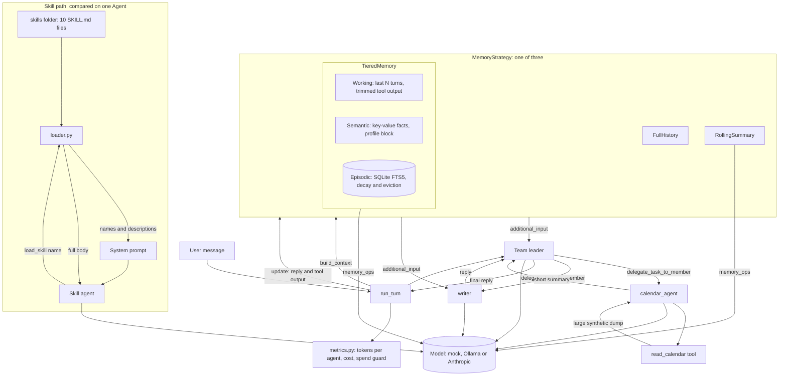

# High-level design

**Reading the diagram.** Each turn, `run_turn` asks the memory strategy for context. It gives that context to the leader and `writer` through Agno's `additional_input`, then runs the team. `calendar_agent` gets only its task. After the run, `run_turn` adds up tokens per agent and hands the reply and tool output back to the memory strategy. Model calls made by memory are counted separately as `memory_ops`.
